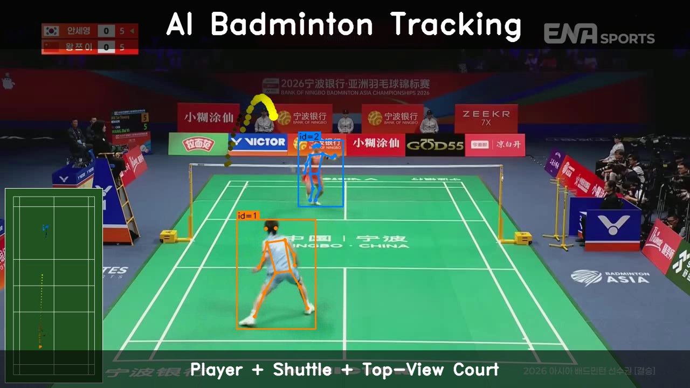
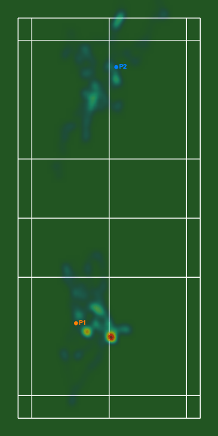

<div align="center">

# RallyLens

**Badminton match video → player & shuttle tracking → court visualization → Korean-language LLM rally analysis report**

[](https://www.python.org/)
[](https://opensource.org/licenses/MIT)
[](web/LICENSE)
[](https://docs.astral.sh/uv/)

YOLO11-pose · ByteTrack · TrackNetV3 · Vertex AI Gemini

**[🇺🇸 English](README.md)** · **[🇰🇷 한국어](README.ko.md)**

</div>

---

## Web App

**[Open RallyLens Web →](https://yeonseong-lee.github.io/rallylens/)**

The static React app analyzes local MP4/WebM files entirely in desktop Chrome using
WebGPU and WebCodecs. Videos and analysis results are kept in browser memory and are
not uploaded or persisted. It supports singles and doubles clips up to 60 seconds,
manual court correction, identity correction, individual/team metrics, local overlay
export, and an optional English report using Chrome's built-in LanguageModel API.

> [!IMPORTANT]
> The deployed UI is currently a **technical preview**. The release model manifest is
> intentionally empty because the existing TrackNet checkpoint has not yet passed
> redistribution-license review and the public golden-set release gates. The app
> therefore stops safely at model initialization instead of producing unverified or
> simulated analysis. See [the web app documentation](web/README.md) for details.

The web app requires desktop Google Chrome 148 or newer with hardware acceleration,
WebGPU, and WebCodecs. The Python CLI below remains the working reference
implementation.

---

## Demo

[](https://youtu.be/fKwac0CsBLc)

> ▶ **[Watch on YouTube](https://youtu.be/fKwac0CsBLc)** — player bounding boxes/skeletons, shuttle trail, and a bottom-left court top-view PIP

### Court Trajectory



*Player & shuttle trails over a heatmap backdrop.*

### LLM Rally Analysis Report

[View the full report →](outputs/demo/report_demo.md)

<details>
<summary>Report preview (click to expand)</summary>

> **Central Dominance vs. Wide-Ranging Defense: A 17-Second Intense Rally Analysis**
>
> A fast-paced, 24-shot rally lasting 17 seconds. Player 1 ran the point efficiently with minimal movement (40.3m), staying centered on the court's middle (76.3%) and mid-depth zone (74.5%). Player 2, by contrast, covered nearly 1.5x more ground (59.5m) and was pushed back into the rear court (57.9%), burning stamina to defend a wider area.

</details>

---

## Features

- **Player tracking** — YOLO11-pose skeleton estimation + ByteTrack multi-object tracker, auto-selecting the 2 singles players
- **Shuttlecock tracking** — TrackNetV3 sliding-window heatmap inference with **temporal ensemble voting** (multi-window consensus, see `docs/UPGRADES.md`) recovers high-speed shuttle trajectories
- **Trajectory rectification** — InpaintNet + linear gap-fill repairs occluded frames, with a **floor gate** that refuses to fabricate landings (`docs/TRACKNETV3.md`, `docs/UPGRADES.md`)
- **Rally event detection** — rule-based landing / hit / out_of_frame events from the repaired trajectory (ported from BadmintonTrackNet, `docs/EVENTS.md`)
- **Shot classification** — local, rule-based stroke types (smash / drive / drop / clear / net) from hit events, no cloud API (`docs/SHOTS.md`)
- **Court calibration** — Hough-based automatic corner detection (or an interactive manual picker)
- **Visualization** — overlay MP4 (with a top-view PIP) + a court top-view trajectory GIF (heatmap background)
- **LLM analysis report** — Vertex AI Gemini structured output auto-generates a Korean-language rally analysis
- **One-command CLI** — `uv run rallylens run <url>` handles download through tracking to shots in a single call (events + shots run automatically)

---

## Quick Start

### Install

```bash
git clone https://github.com/YeonSeong-Lee/rallylens
cd rallylens
brew install ffmpeg        # macOS; Linux: sudo apt install ffmpeg
uv sync
```

### Run

```bash
# 1. Download from YouTube + track players (one-command)
uv run rallylens run https://www.youtube.com/watch?v=<id>

# 2. Shuttle tracking → court calibration → visualization
uv run rallylens detect-shuttle data/raw/<video_id>.mp4
uv run rallylens calibrate data/raw/<video_id>.mp4
uv run rallylens viz data/raw/<video_id>.mp4

# 3. Korean-language LLM analysis report (needs Vertex AI setup — see below)
uv run rallylens report data/raw/<video_id>.mp4
```

<details>
<summary><strong>Optional: Vertex AI report setup</strong> — needed only for the Gemini-based LLM report</summary>

`rallylens report` calls Google Cloud Vertex AI Gemini to write a Korean-language rally analysis report. Only set this up if you need the LLM report feature.

#### 1. Prepare a GCP project

- Create or select a project in the [Google Cloud Console](https://console.cloud.google.com/).
- Enable the **Vertex AI API**.

```bash
gcloud services enable aiplatform.googleapis.com --project=<your-project-id>
```

#### 2. Authenticate (Application Default Credentials)

```bash
gcloud auth application-default login
```

A browser window opens — sign in with your Google account. You only need to run this once per local machine.

#### 3. Install dependencies and set environment variables

```bash
uv sync --extra report          # installs the optional google-genai dependency
cp .env.example .env            # copy the environment variable template
```

Open `.env` and fill in the values:

```dotenv
GOOGLE_CLOUD_PROJECT=your-gcp-project-id   # required
GOOGLE_CLOUD_LOCATION=us-central1          # optional (default: us-central1)
```

#### 4. Verify

```bash
uv run rallylens report data/raw/<video_id>.mp4
```

The default model is `gemini-2.5-pro`. Change it with the `--model` option.

> To check the deterministic metrics only, without authentication, run `rallylens report <video> --metrics-only`. It generates only `metrics.json` and skips the Gemini call.

</details>

---

## CLI Reference

Artifact paths are stored under `data/`, keyed by `<video_id>` = the input filename stem.

### `run` — end-to-end pipeline

```bash
uv run rallylens run <url-or-path> [OPTIONS]
```

Uses a local file directly, or downloads a YouTube URL and runs player tracking in one go.

<details>
<summary>Option details</summary>

| Option | Default | Description |
|---|---|---|
| `--tracker [none\|bytetrack]` | `bytetrack` | Choose the tracker |
| `--singles / --no-singles` | `singles` | Keep only the 2 most stable track IDs (singles matches) |
| `--imgsz` | `1280` | YOLO inference image size |

</details>

### `ingest` — YouTube download

```bash
uv run rallylens ingest <youtube-url> [OPTIONS]
```

Output: `data/raw/<video_id>.mp4`. Clipped downloads are named `<video_id>_<start>s_<end>s.mp4`.

<details>
<summary>Option details</summary>

| Option | Default | Description |
|---|---|---|
| `--start` | none | Start time (seconds, or `MM:SS` / `HH:MM:SS`) |
| `--end` | none | End time |
| `--force / --no-force` | `no-force` | Ignore the cache and re-download |

</details>

### `detect` — player tracking

```bash
uv run rallylens detect <video_path> [OPTIONS]
```

Output: `data/detections/<video_id>/<video_id>_players.jsonl`

<details>
<summary>Option details</summary>

| Option | Default | Description |
|---|---|---|
| `--tracker [none\|bytetrack]` | `bytetrack` | Choose the tracker |
| `--singles / --no-singles` | `singles` | Keep only the 2 most stable track IDs (singles matches) |
| `--imgsz` | `1280` | YOLO inference image size |

</details>

### `detect-shuttle` — shuttlecock tracking

```bash
uv run rallylens detect-shuttle <video_path> [OPTIONS]
```

Output: `data/tracks/<video_id>/<video_id>_shuttle.jsonl`

<details>
<summary>Option details</summary>

| Option | Default | Description |
|---|---|---|
| `--weights` | `models/shuttle_tracknet.pth` | Path to TrackNetV3 weights |
| `--no-rectify` | off | Skip trajectory rectification (linear gap-fill + InpaintNet) |

</details>

### `detect-events` — rally event detection (landing / hit / out_of_frame)

```bash
uv run rallylens detect-events <video_path> [OPTIONS]
```

Needs a shuttle track first (from `detect-shuttle`). Rule-based detector
ported from [ZSHYC/BadmintonTrackNet](https://github.com/ZSHYC/BadmintonTrackNet)
— see `docs/EVENTS.md` for the rule bank, coordinate convention, and how to
enable the optional BounceNet classifier later.

Output: `data/events/<video_id>/<video_id>_events.jsonl`

| Option | Default | Description |
|---|---|---|
| `--fps` | 30 | Video framerate for kinematics scaling |

### `detect-shots` — shot classification (smash / drive / drop / clear / net)

```bash
uv run rallylens detect-shots <video_path> [OPTIONS]
```

Needs a shuttle track + events first (from `detect-shuttle` +
`detect-events`). Local rule-based classifier — no cloud API — that labels
each `hit` event with a stroke type using shuttle speed, vertical velocity,
and hit height. See `docs/SHOTS.md` for the rule bank and tuning.

Output: `data/shots/<video_id>/<video_id>_shots.jsonl`

| Option | Default | Description |
|---|---|---|
| `--fps` | 30 | Video framerate for kinematics scaling |

### `calibrate` — court calibration

```bash
uv run rallylens calibrate <video_path> [OPTIONS]
```

Output: `data/calibration/<video_id>/corners.json`

<details>
<summary>Option details</summary>

| Option | Default | Description |
|---|---|---|
| `--samples` | `20` | Number of sample frames used for court detection |
| `--interactive` | off | Click/confirm corners manually in an OpenCV window |

</details>

### `viz` — visualization

```bash
uv run rallylens viz <video_path> [OPTIONS]
```

Requires the `detect`, `detect-shuttle`, and `calibrate` artifacts beforehand.

Output: `data/viz/<video_id>/{<video_id>_overlay.mp4, viz_court.gif}`

<details>
<summary>Option details</summary>

| Option | Default | Description |
|---|---|---|
| `--overlay / --no-overlay` | `on` | Player + shuttle overlay MP4 (includes a top-view PIP if court calibration exists) |
| `--court / --no-court` | `on` | Court top-view trajectory GIF (with heatmap background) |
| `--trail-len` | `30` | Shuttle trail length, in frames |
| `--court-stride` | `5` | Frame interval to include in the court GIF |
| `--court-scale` | `0.5` | Downscale ratio for the court GIF |

</details>

### `report` — Vertex AI-based rally analysis report

```bash
uv run rallylens report <video_path> [OPTIONS]
```

Prerequisites: `detect` and `calibrate` artifacts are required. `detect-shuttle` is recommended (it still works without it, but shot/rally counts will be 0).
See the collapsible block in the [Quick Start](#quick-start) section for Vertex AI setup.

<details>
<summary>Option details</summary>

| Option | Default | Description |
|---|---|---|
| `--model` | `gemini-2.5-pro` | Vertex AI Gemini model ID |
| `--temperature` | `0.4` | Sampling temperature (0.0–1.0) |
| `--metrics-only` | off | Skip the LLM call and only generate `metrics.json` (no auth needed) |
| `--skip-viz` | off | Skip auto-rendering the court GIF |

Output:

```
data/reports/<video_id>/
├── metrics.json     # deterministic metrics (MatchMetrics schema v1)
├── report.json      # Gemini structured response (ReportOutput schema v1)
└── report.md        # rendered markdown report — plays the GIF in GitHub/VS Code/Obsidian
```

</details>

---

## Output Layout

```
data/
├── raw/                 # source videos
├── detections/          # player tracking JSONL
├── tracks/              # shuttle tracking JSONL
├── calibration/         # court corner JSON
├── viz/                 # overlay MP4 + court GIF (heatmap background)
└── reports/             # metrics.json + report.json + report.md
```

> `data/` is gitignored. Public-facing samples live in `outputs/demo/`.

---

## Architecture

**"One module, one concern — dependencies point in a single direction."**

```
cli → pipeline → { vision, analysis, llm, viz, ingest }
                         ↓
                 { config, serialization, common, domain }
```

- Only `vision` imports `ultralytics`/`cv2` directly — model code never leaks outside this layer
- Only `llm` imports `google.genai` directly — it's an optional dependency, so the rest of the CLI works without `report`
- `analysis` computes deterministic metrics only — the LLM is limited to interpretation and coaching suggestions

<details>
<summary><strong>Detailed architecture</strong> — file tree, data flow, design decisions</summary>

### Layer structure

```
src/rallylens/
├── cli.py              ← click group. Subcommands are thin shims over pipeline.
├── pipeline/           ← Orchestration. Wires vision/analysis/llm/viz to io.
│   ├── io.py           ← Single source for video_id → artifact paths + save/load.
│   ├── orchestrator.py ← run_full_pipeline (ingest + detect)
│   ├── shuttle.py      ← run_shuttle_pipeline (TrackNetV3)
│   ├── court.py        ← run_court_detection
│   └── report.py       ← run_report_pipeline (metrics + viz + Gemini)
├── vision/             ← CV inference only. Only this layer imports ultralytics/cv2 directly.
│   ├── detect_track.py ← YOLO11-pose + ByteTrack → Detection
│   ├── tracknet.py        ← TrackNetV3 model definition
│   ├── shuttle_tracker.py ← TrackNetV3 inference → ShuttlePoint, HitEvent
│   ├── court_detector.py  ← Hough → CourtCorners
│   └── court_picker.py   ← OpenCV interactive corner picker
├── analysis/           ← Deterministic match metrics (no LLM).
│   └── metrics.py      ← compute_match_metrics → MatchMetrics
├── llm/                ← Vertex AI Gemini wrapper. Only this layer imports google.genai directly.
│   ├── vertex_client.py ← ADC-based genai.Client factory
│   ├── report_schema.py ← ReportOutput, PlayerInsight (structured response)
│   ├── prompt.py       ← SYSTEM_PROMPT_KO
│   └── report.py       ← generate_report + render_report_markdown
├── viz/                ← Artifact rendering only. No model inference here.
│   ├── _utils.py       ← Shared helpers: court diagram, homography, trails, etc.
│   ├── overlay.py      ← Video overlay MP4 (includes top-view PIP compositing)
│   └── viz_court.py    ← Top-view trajectory GIF (with heatmap background)
├── ingest/             ← yt-dlp wrapper (with caching)
├── domain/             ← Domain models such as VideoProperties
├── common.py           ← Logger, .env loader, ffmpeg check, video I/O context manager
├── serialization.py    ← pydantic ↔ JSON/JSONL helpers
└── config.py           ← Path constants only. Imports nothing from rallylens itself.
```

### Dependency direction

```
cli → pipeline → { vision, analysis, llm, viz, ingest }
                         ↓
                 { config, serialization, common, domain }
```

- `config.py` is **the only module that imports nothing from rallylens itself**. When the filesystem layout changes, every fix converges on this one file.
- `pipeline.io` is the **single source** for the `(video_id) → Path` mapping and the `save_*` / `load_*` helpers. Adding a new artifact kind means adding its path, save, and load here — and nowhere else.
- Only `vision` imports `ultralytics`/`cv2` directly. Model handler code never leaks outside this layer, so the mypy override in `pyproject.toml` is also only needed in one place.
- Only `llm` imports `google.genai` directly. `google-genai` is an optional dependency, so users who only need `detect`/`viz` carry no install burden. `cli.py` treats `from rallylens.pipeline import run_report_pipeline` as a **lazy import**, so the SDK only loads when the `report` command actually runs.
- `analysis` imports the court-geometry utilities from `viz._utils` (`compute_homography`, `project_point`, `extract_hit_events`). This is a direct peer-layer dependency and, strictly speaking, an inversion — a `viz/_utils.py:8` TODO documents the plan to promote court-geometry down into `vision`.

### `rallylens report` data flow

```
detections.jsonl  ┐
shuttle.jsonl     ┼→ analysis.compute_match_metrics ─→ metrics.json
corners.json      ┘                  │
                                     ├──→ viz.render_viz_court ─→ viz_court.gif
                                     └──→ llm.generate_report ──→ ReportOutput ─→ report.json
                                                                         │
                                                                         ▼
                                                       llm.render_report_markdown
                                                                         │
                                                                         ▼
                                                             report.md (embeds GIF/PNG)
```

### Key design decisions

1. **Deterministic ↔ LLM separation**: Python computes the numbers; Gemini only writes interpretation and coaching suggestions. Raw detections never go into the prompt, so token cost is constant regardless of input size, and the risk of hallucinated numbers disappears.
2. **Pydantic structured output**: `response_schema=ReportOutput` forces Gemini to conform to the schema.
3. **Markdown is a deterministic template**: `render_report_markdown` doesn't call the LLM a second time. Numbers are quoted directly from `MatchMetrics`, and the court GIF is embedded into `report.md` as a relative path via `os.path.relpath`.
4. **Viz auto-render**: if `viz_court.gif` doesn't exist, `run_report_pipeline` renders it on the fly (the heatmap is baked into the GIF background). A render failure only logs a warning — report generation continues.
5. **`--metrics-only` escape hatch**: skips the Gemini call and authentication, generating only `metrics.json`. Lets CI and local tuning run the pipeline at no cost.

For additional conventions (coding style, mypy config, notes on adding new layers), see [`CLAUDE.md`](CLAUDE.md).

</details>

---

## Development

```bash
uv run pytest             # tests
uv run ruff check src/    # lint
uv run ruff format src/   # format
uv run mypy               # type-check
```

Coding conventions, mypy overrides, and notes on adding new layers are documented in [`CLAUDE.md`](CLAUDE.md).

---

## References

### Algorithms & Models

| Project | Purpose | Link |
|---|---|---|
| TrackNetV3 | Shuttlecock tracking (sliding-window heatmap inference) | [qaz812345/TrackNetV3](https://github.com/qaz812345/TrackNetV3) |
| TRACE | Court detection · hit event detection · shuttle top-view projection | [hgupt3/TRACE](https://github.com/hgupt3/TRACE) |
| Ultralytics YOLO11 | Player pose estimation + ByteTrack integration | [docs.ultralytics.com](https://docs.ultralytics.com/) |
| ByteTrack | Multi-object tracking (track ID persistence) | [ifzhang/ByteTrack](https://github.com/ifzhang/ByteTrack) |
| Vertex AI Gemini | Korean-language rally analysis report generation (structured output) | [cloud.google.com/vertex-ai](https://cloud.google.com/vertex-ai) |

### Libraries

| Library | Link |
|---|---|
| google-genai (Python SDK) | [googleapis/python-genai](https://github.com/googleapis/python-genai) |
| OpenCV | [opencv.org](https://opencv.org/) |
| PyTorch | [pytorch.org](https://pytorch.org/) |
| Pydantic | [docs.pydantic.dev](https://docs.pydantic.dev/) |
| yt-dlp | [yt-dlp/yt-dlp](https://github.com/yt-dlp/yt-dlp) |
| Click | [click.palletsprojects.com](https://click.palletsprojects.com/) |
| uv | [docs.astral.sh/uv](https://docs.astral.sh/uv/) |

---

## License

**MIT** (see [LICENSE](LICENSE)). 

This repo adapts substantial code and ships model weights from third-party
open-source projects. Per MIT terms, the full attribution map — source repos,
exact upstream file paths, licenses, and copyright holders — lives in
**[THIRD_PARTY_NOTICES.md](THIRD_PARTY_NOTICES.md)**:

- **TrackNetV3** ([qaz812345/TrackNetV3](https://github.com/qaz812345/TrackNetV3)) — shuttle tracking architecture, InpaintNet rectifier integration, and the shipped `shuttle_tracknet.pth` / `inpaintnet_best.pth` weights (MIT, © 2024 qaz812345).
- **BadmintonTrackNet** ([ZSHYC/BadmintonTrackNet](https://github.com/ZSHYC/BadmintonTrackNet)) — the rule-bank event detector in `analysis/events/` (MIT, © 2024 qaz812345).
- Original RallyLens pipeline ([YeonSeong-Lee/rallylens](https://github.com/YeonSeong-Lee/rallylens)) — declared MIT upstream.

YOLO11 weights are [AGPL-3.0](https://www.gnu.org/licenses/agpl-3.0.html); the
`web/` app is AGPL-3.0-only (see `web/LICENSE`). This project is for
portfolio / educational use only.
